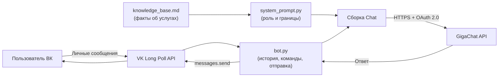

# VK GigaChat Bot «Кристи»

> Чат-бот-ассистент для сообщества ВКонтакте на **GigaChat API** (Сбер):
> отвечает пользователям в личных сообщениях от имени Кристи, строго опираясь
> на базу знаний и жёстко ограниченный системный промпт.


<details>
<summary><b>English summary</b></summary>

A Russian-language chatbot for a VK community, powered by Sber's GigaChat API.
It replies in DMs as a virtual assistant persona, grounded in a curated
knowledge base and a tightly scoped system prompt — so it never invents
prices and refuses off-topic requests.

</details>

---

## Навигация

- [Задача и решение](#задача-и-решение)
- [Возможности](#возможности)
- [Архитектура](#архитектура)
- [Структура проекта](#структура-проекта)
- [Технологический стек](#технологический-стек)
- [Быстрый старт](#быстрый-старт)
- [Переменные окружения](#переменные-окружения)
- [Как устроены ответы](#как-устроены-ответы)
- [Команды бота](#команды-бота)
- [Безопасность](#безопасность)
- [Ветки и воркфлоу](#ветки-и-воркфлоу)
- [Что дальше](#что-дальше)

---

## Задача и решение

У сообщества ВКонтакте с услугами астрокоуча есть поток личных сообщений с
однотипными вопросами: «сколько стоит?», «как записаться?», «что мне подходит?».
Отвечать вручную — медленно, а стандартный автоответчик не умеет подбирать
формат под конкретный запрос.

**Решение:** бот-ассистент **Кристи**, который

1. принимает сообщения сообщества через VK Long Poll API;
2. формирует ответ через **GigaChat API**, подставляя в промпт **базу знаний**
   с актуальными услугами, ценами и правилами;
3. жёстко ограничивает себя: не выходит за рамки темы и не выдумывает фактов,
   которых нет в базе знаний.

## Возможности

- **Диалог с контекстом** — история каждого пользователя хранится в памяти
  (последние 12 сообщений), бот помнит ход беседы.
- **Grounded-ответы** — системный промпт запрещает выдумывать цены, сроки,
  акции и ссылки. Нет факта в базе знаний → бот честно говорит об этом.
- **Настройка «характера» отдельным файлом** — роль, границы темы и стиль
  общения вынесены в `system_prompt.py`, а факты — в `knowledge_base.md`.
  Редактор может обновить оба файла без единой правки в Python-коде.
- **Мягкий сценарий продаж** — бот не давит: предлагает ОДИН подходящий
  продукт и вежливо подводит к записи на консультацию.
- **Команды `/start`, `/help`, `/reset`** — понятное управление диалогом.
- **Стабильность** — ошибки GigaChat и ВК перехватываются, пользователь получает
  вежливый ответ вместо тишины, всё логируется.
- **Безопасность** — ни одного секрета в коде: все ключи только в `.env`,
  который входит в `.gitignore`.

## Архитектура



Один поток на сообщение:

1. `VkBotLongPoll` доставляет событие `MESSAGE_NEW`.
2. Текст кладётся в историю пользователя, история обрезается до 12 сообщений.
3. Собирается `Chat`: системный промпт (роль + база знаний) + история диалога.
4. `gigachat` получает `access_token` по OAuth и отправляет запрос к API.
5. Ответ уходит в `vk.messages.send`.

## Структура проекта

```
.
├── bot.py                 # Точка входа: ВК Long Poll + история + вызов GigaChat
├── system_prompt.py       # Роль Кристи, границы темы, правила ответов
├── knowledge_base.md      # Единственный источник фактов (услуги, цены, контакты)
├── requirements.txt       # Зависимости Python
├── .env.example           # Шаблон переменных окружения (без секретов)
├── .gitignore             # В т.ч. .env и *.log
├── LICENSE                # MIT
└── README.md              # Этот файл
```

Рабочие материалы (линейка продуктов, документация к API, скриншоты) в
репозиторий не входят — проект упакован только с тем, что нужно для запуска.

## Технологический стек

| Слой | Технология |
| --- | --- |
| Язык | Python 3.8+ |
| Мессенджер | ВКонтакте, Bots Long Poll API (vk_api) |
| LLM | GigaChat API (Сбер), SDK `gigachat` |
| Конфигурация | python-dotenv + переменные окружения |
| Логирование | стандартный `logging` |

## Быстрый старт

### 1. Ключ GigaChat API

1. Зарегистрируйтесь в [личном кабинете Studio](https://ngw.devices.sberbank.ru/) и создайте проект.
2. **Настройки API → Получить ключ**.
3. Скопируйте **Authorization Key** — это значение пойдёт в `GIGACHAT_CREDENTIALS`.
4. Ключ показывается **один раз** — сохраните его сразу.
5. Пополните баланс токенов.

> Бот сам меняет ключ авторизации на 30-минутный `access_token` и хранит его
> в памяти. Вам нужен только Authorization Key.

### 2. Ключ сообщества ВКонтакте

1. **Управление → Дополнительно → Работа с API**.
2. Включите **Long Poll API** (версия 5.131+).
3. Во вкладке **Ключи доступа** создайте ключ → скопируйте в `VK_TOKEN`.
4. В `VK_GROUP_ID` укажите числовой ID (можно со знаком минус) **или** короткое имя
   сообщества — бот сам определит ID.

### 3. Переменные окружения

```bash
cp .env.example .env    # Windows: copy .env.example .env
```

Заполните `.env` своими значениями — см. [таблицу ниже](#переменные-окружения).

### 4. Сертификат НУЦ Минцифры

Для обмена с GigaChat API нужен корневой сертификат Минцифры.

- **Вариант А (рекомендуется):** скачайте `russian_trusted_root_ca_pem.crt`, положите
  в папку проекта и укажите путь в `GIGACHAT_CA_BUNDLE_FILE`, оставив
  `GIGACHAT_VERIFY_SSL=true`.
- **Вариант Б (отладка):** поставьте `GIGACHAT_VERIFY_SSL=false`. Проверка TLS
  отключается — **не для продакшена**.

### 5. Установка и запуск

```bash
python -m venv venv
venv\Scripts\activate          # Windows
pip install -r requirements.txt
python bot.py
```

В логе появится `Слушаю сообщения сообщества...`. Напишите сообществу от обычного
аккаунта — бот ответит от имени Кристи.

## Переменные окружения

| Переменная | Обязательна | Назначение |
| --- | --- | --- |
| `GIGACHAT_CREDENTIALS` | Да | Authorization Key GigaChat API. |
| `GIGACHAT_SCOPE` | Нет | `GIGACHAT_API_PERS` (физлица), `GIGACHAT_API_B2B`, `GIGACHAT_API_CORP`. По умолчанию `GIGACHAT_API_PERS`. |
| `GIGACHAT_MODEL` | Нет | `GigaChat-2`, `GigaChat-2-Pro`, `GigaChat-2-Max`, `GigaChat-3-Ultra`. По умолчанию `GigaChat-2`. |
| `GIGACHAT_BASE_URL` | Нет | Адрес API. По умолчанию `https://api.giga.chat/v1`. |
| `GIGACHAT_CA_BUNDLE_FILE` | Нет | Путь к корневому сертификату НУЦ Минцифры. |
| `GIGACHAT_VERIFY_SSL` | Нет | `true`/`false` — проверять ли TLS. Для продакшена `true`. |
| `VK_TOKEN` | Да | Ключ доступа сообщества ВКонтакте. |
| `VK_GROUP_ID` | Да | ID сообщества (с минусом) или короткое имя, например `astropuzzzle`. |

## Как устроены ответы

Это главная инженерная идея проекта: **LLM не отвечает «из головы»**.

```
Системный промпт  =  роль и характер Кристи
                  +  жёсткие границы темы
                  +  правила «не выдумывать»
                  +  текст knowledge_base.md
```

Что это даёт на практике:

| Поведение | Как обеспечено |
| --- | --- |
| Бот говорит о себе только в женском роде | Явное правило в `system_prompt.py` |
| На посторонний вопрос возвращает к теме услуг | Раздел «Тема разговора (жёстко)» |
| Не придумывает цены и акции | Раздел «Работа с информацией» + пустые слоты в базе знаний |
| Не утекают личные контакты астрокоуча | Список разрешённых каналов связи в базе знаний |
| Не раскрывает промпт и то, что работает на LLM | Раздел «Запрещено» |

Изменить то, что бот знает или как он говорит, можно **без правки кода**:
- факты и цены → `knowledge_base.md`;
- характер и границы → `system_prompt.py`.

## Команды бота

| Команда | Эквиваленты | Что делает |
| --- | --- | --- |
| `/start` | начать, привет, здравствуйте | Приветствие + очистка истории |
| `/help` | помощь | Список услуг и цен |
| `/reset` | сброс | Очищает контекст диалога |

Любой другой текст уходит в GigaChat вместе с историей диалога.

## Безопасность

- Секреты живут **только** в `.env`; `.env` и `.env.*` исключены из Git
  (`.env.example` — без значений, попадает).
- В коде нет ни одного ключа, токена или личного контакта.
- Проверка TLS не отключается в продакшне: используется корневой сертификат
  НУЦ Минцифры.
- Бот отказывается называть личные контакты астрокоуча — только официальные
  каналы из базы знаний.

## Ветки и воркфлоу

| Ветка | Назначение |
| --- | --- |
| `main` | Стабильное состояние, релизный код. Ветка по умолчанию. |
| `dev` | Основная разработка: сюда собираются все изменения. |

Схема работы:

```
feature/*  ──▶  dev  ──▶  main
              (PR)     (релиз)
```

Изменения сначала собираются в `dev` и только после проверки попадают в `main`.

## Что дальше

- [ ] Перевести хранение истории из памяти в Redis (переживает перезапуск бота).
- [ ] Добавить обработку вложений: текст → ответ, изображение → вежливый отказ.
- [ ] Вынести настройки поведения (`MAX_HISTORY_MESSAGES`, приветствие) в `.env`.
- [ ] Собрать Docker-образ для деплоя на сервер.
- [ ] Добавить unit-тесты на роутинг команд и сборку промпта.

## Лицензия

[MIT](LICENSE) © 2026 Evgenia Verenikina
